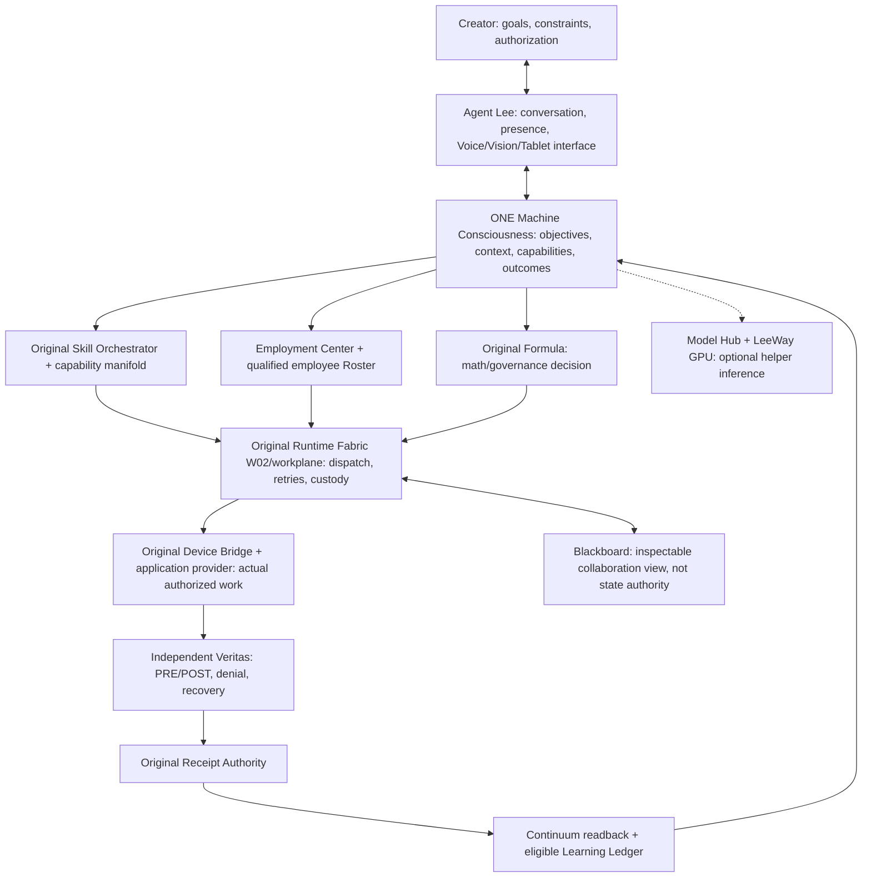

<!--
LEEWAY HEADER — DO NOT REMOVE
REGION: LEEWAY.MACHINE_CONSCIOUSNESS.MATRIX_ARCHITECTURE
TAG: LEEWAY.MACHINE_CONSCIOUSNESS.MATRIX_ARCHITECTURE.V1
5WH:
WHAT = Source-grounded map of Creator's Matrix as the existing one Machine Consciousness.
WHY = Build actual goal-driven worker composition, authorized execution, observation, recovery and learning without creating another controller.
WHO = Creator/Human Authority with canonical Machine Consciousness source owner; GPT-6 outside contributor, NOT Agent Lee.
WHERE = docs/architecture/matrix-machine-consciousness-composition-20261122.md.
WHEN = 2026-11-22.
HOW = Reconcile canonical Universal Employee, cross-repository integration, M01–M15 preservation, original Runtime carrier and owner-specific acceptance.
LICENSE = Existing repository terms remain unchanged.
-->

# LeeWay Matrix = one shared Machine Consciousness

**Creator directive, 2026-11-22:** The Matrix *is* the existing deterministic Machine Consciousness. Agent Lee is its identity/interface. Applications, employed workers, skills, optional compact models and device/compute fabrics are capability providers, **not separate consciousnesses**. "Consciousness" is the product system name, not a scientific claim of subjective sentience or biological experience.

This document adds no second agent factory, industry brain, scheduler, skill registry, model authority, Formula, verifier, durable database, receipt store or job queue. It is subordinate to [canonical cross-repository ownership](leeway-cross-repository-integration-v1.md), [universal-employee substrate](../../training/contracts/leeway-universal-employee-consciousness.v1.json), the original 12-stage Engineering Loop and the existing Creator mission.

## 1. Exact ownership and two interacting loops

**Outer objective loop:** perceive user intent → recover existing objective → understand context → plan outcomes → compose authorized capabilities → observe results → preserve state → propose eligible improvements.

**Inner engineering loop, original 12 stages:** INVESTIGATE → DIAGNOSE → PLAN → IMPLEMENT → TEST → VALIDATE → REPAIR → RETEST → VERIFY → EVIDENCE → CHECKPOINT → CONTINUE. The first loop preserves the Creator's actual objective; the second makes each technical work item testable and recoverable.

**Execution and authority note:** This chart is conceptual, not a claim that every edge is implemented. Formula and Veritas PRE/POST follow original owning contracts; the order of source-provider checks may differ by action. Models advise but do not execute or formally verify. Blackboard messages cannot substitute for native Runtime completion records.

## 2. Eight Machine Consciousness operations (behavioral composition, not fabricated M module names)

| Cognitive function | Real input | Machine Consciousness output | Existing executor / gate |
| --- | --- | --- | --- |
| PERCEIVE_REQUEST | qualified text, speech or authorized visual signal | retained objective and user acceptance | Agent Lee UI/Voice/Vision; native ingestion proof required |
| RECOVER_CONTEXT | Continuum readback, prior accepted checkpoint, relevant Digital Brain references | restored exact identity, permissions and remaining tasks | Continuum owns durable state, not `MEMORY.md` as a mutable diary |
| FORM_GOAL | original objective, source-verified cross-domain constraints | bounded task/dependency graph and expected outcome | Machine Consciousness; Formula for applicable decision |
| COMPOSE_CAPABILITIES | Employment/roster grants, original Skill Orchestrator, application catalog, model candidates | smallest authorized candidate worker weave; prefer reuse | Original Employment/Skills; candidate map does not confer grants |
| REQUEST_AUTHORIZED_ACTION | admitted native work order and owner approval | requested execution with correlation and idempotency constraints | Original Runtime W02 + Tool Gateway + Device Bridge |
| OBSERVE_OUTCOME | real runtime result, measured post-state, failure/denial | factual gap, compare against acceptance | independent Veritas checks actual evidence |
| PRESERVE_CONTINUITY | actual receipts, workplane state, artifacts, source refs | resilient checkpoint eligible for real write/readback | Receipt Authority + Continuum + Content Vault for artifacts |
| PROPOSE_VERIFIED_IMPROVEMENT | observed failures and successes, qualified evidence | source-versioned skill/worker/route candidate; not automatic retraining | original Skill Factory/Veritas/Receipt/Learning admission |

A single service may span healthcare-adjacent accessibility and logistics while retaining independent privacy/safety decisions. Industry packs supply context, not another brain or worker identity. No model parameter count implies claimed intelligence.

## 3. Implementation ownership and current source evidence

| Boundary | Original source evidence | Current stage / hard limit |
| --- | --- | --- |
| Core constitutional and employee binding | `training/contracts/leeway-runtime-constitution.v1.json`, `training/contracts/leeway-universal-employee-consciousness.v1.json` | Canonical **design**; no claim of universally enforced physical worker admission |
| M01–M15 / Guardian | standalone repo `README.md` explicitly requires preservation | Individual M01–M15 module names/code map **NOT RECOVERED** from current original standalone source: do not invent, rename or replace |
| Live/local carrier | Runtime Fabric `machine-consciousness/carrier-server.mjs` | Source actually resides in Runtime Fabric; standalone repo currently contains docs, training and reference code only; standalone migration and live reenrollment remain separate |
| Existing native work order | Runtime Fabric `machine-consciousness/capability-work-order-router.mjs` | `leeway.work-order.v1` with states `PLANNED/BLOCKED/FAILED/HOLD_APPROVAL/EXECUTED_VERIFIED`; injected `resolveRegistration`, `dispatch` and `verifyExecution` are still required. The uncomposed source export fails closed |
| Source-only model help | `training/reference/model-support-convergence.mjs` in Machine Consciousness draft PR #5 | Bounded reports and proposed worker handoffs only; no worker self-creation or independent verification |
| Source-only objective composition and recovery | `training/reference/matrix-objective-composition.mjs` in same draft PR | Source-plan only. Returns cross-domain capability candidate references and read-only reconciliation of *reported* Runtime orders; never starts dispatch, assumes completed state or writes Continuum |
| Skills and specialist selection | Agent Skills original Kernel/Skill Orchestrator, derived expert routing draft PR #47 | 502 source skill files counted at that PR's latest CI; not 502 live providers or employed workers. Original owner must hydrate/admit and execute |
| Memory | fixed `MEMORY.md` contract reported uniform across 12 host boundaries | Do not mutate hash-pinned contract per work milestone. Verify actual local hash via qualified host path; Continuum stores durable task state |
| Blackboard / Tablet | Creator's functional target (real worker event projection, floating live apps) | Specific live event binding and reconnect/restart remains **NOT_VERIFIED** |
| Model Hub/LeeWay GPU | Model Hub Qwen triad PR #8, original GPU provider owned separately | Optional reviewer/teacher; no actual joined on-host inference, weight training, GPU qualification or permission handoff demonstrated |
| Independent evidence | canonical Formula, Veritas, Receipt Authority, Continuum and Learning | No new live end-to-end G4 acceptance from this change; G3 source test != production |

## 4. Objective and interruption-recovery interface

The minimal candidate source implementation is `training/reference/matrix-objective-composition.mjs`:

- `composeMatrixObjective` requires the existing one-substrate `requireConsciousnessBinding` contract, an identified human objective and bounded **source references** for cross-domain contexts, required capabilities, actual roster observations and relevant skill candidates.
- If a qualified existing worker is *reported*, suggest reusing it **after** original Employment/Runtime admission. If only a skill exists, ask original Skill Factory to assess coverage. If neither exists, return a scoped Capability Resilience gap. No authority is inherited from model text or from a skill name.
- `planMatrixObjectiveRecovery` requires the same objective identity, a **reported** Continuum readback, and *observed snapshots* from the existing Runtime work-order route. Missing checkpoint, conflicting order state or unknown owner blocks. Duplicate identical work-order observations are deduplicated.
- A `BLACKBOARD TIMER`, `ACK`, animated widget or model completion claim **cannot advance execution state**. `EXECUTED_VERIFIED` returned by a local Runtime source is a claim to reconcile with actual independent Veritas, canonical receipt and Continuum custody; this source planner does not independently certify it. `FAILED` does not trigger blind re-execution when prior side effects are uncertain.
- No work-order IDs are generated, no queue/store/worker/model is created, no network calls are made. Existing Runtime **must** inspect actual workplane state and preserve idempotency/correlation prior to any resubmission.

### Example: Creator starts an accessible mobility company

This is one objective with source-checked transportation, accessibility, software, staffing, logistics, and customer-operations constraints—not separate healthcare, transport and finance minds. Machine Consciousness composes existing qualified logistics/Office/CRM/IDE workers and original capabilities. Models can critique proposed routes or UI accessibility on authorized evidence. Original Runtime handles real tasks; Blackboard shows actual acknowledgments and outcomes; independent Veritas checks outputs; Continuum readback restores the same work after Tablet restart.

## 5. P0–P7 implementation plan and actual acceptance (from Creator upload)

| Priority | Work item and owning source | Passing evidence |
| --- | --- | --- |
| **P0** | Recover actual canonical M01–M15/Guardian source inventory, carrier commands, identity and custody | Original modules pinned by exact source SHA/owner; no duplicate brain or carrier |
| **P1** | Wire Matrix objective to original Employment roster + hashed Skill Orchestrator candidates | Qualified existing employee selected with real rights and admissible skill, no new authority |
| **P2** | Bind Blackboard to **actual** Runtime work-order events rather than simulated clocks | No completed status without measured result, independent gate and canonical receipt linkage |
| **P3** | Bind Continuum readback and Content Vault artifact custody to objective recovery | Restart/reconnect recovers exact objective, workOrderId, worker assignment and artifact refs without duplicate side effects |
| **P4** | Qualify one bounded application action via original adapter | Real output compared with acceptance; scoped rollback/denial handling |
| **P5** | Connect qualified Voice/Vision/Device Bridge and optional models | Original managed adapters really exchange source-ref signals, no model authority |
| **P6** | Qualify cross-domain expertise and worker composition | Same objective and original core satisfy two distinct domain workflows under rights constraints |
| **P7** | Independent end-to-end G4 acceptance/recovery | Formula + real native execution + Veritas PRE/POST + canonical receipt + Continuum readback + Learning admission only when eligible |

**Current source action:** create one small deterministic objective/recovery **candidate** in existing PR #5. This begins P1/P3 interface design but does not complete P0–P7. Do not promote it until original executable carrier integration and actual production proof are available. Avoid fixed drive paths as runtime identity.

## 6. Stage and safety boundaries

Creator's 12-stage engineering loop still governs implementation. Tests of deterministic helper code can prove that it refuses to create shadow workers, bypass original authority, treat a timer as actual execution or resume without Continuum. They cannot prove the existing Device Bridge, Formula, Voice, Vision, original standalone Carrier, local model weights or independent Veritas executed.

No live worker dispatch, long-running scheduler, persistent data, new training, secret usage, runtime permissions, production admission, M01–M15 renumbering, memory-hash mutation or rollback of existing user work is authorized by this source PR. Rollback is the current isolated draft PR (unmerged); original main and current carriers remain unchanged.
